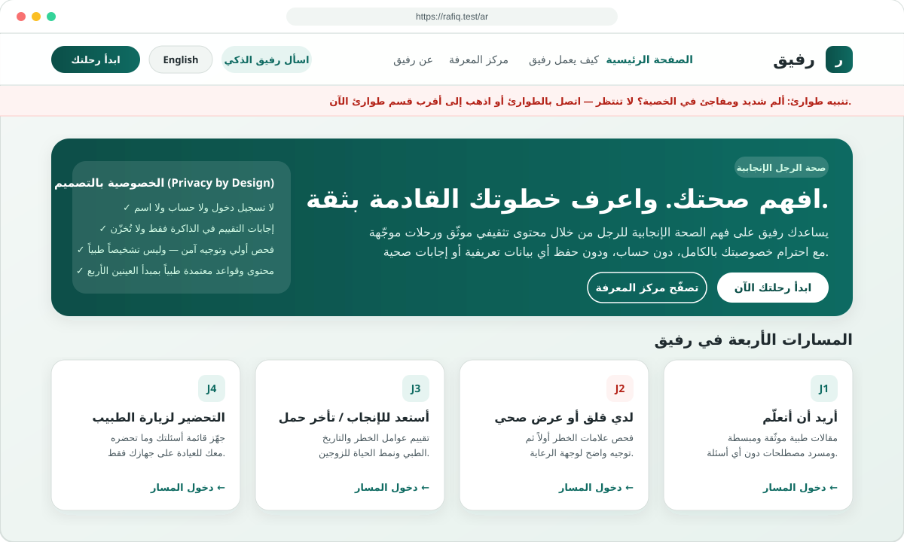
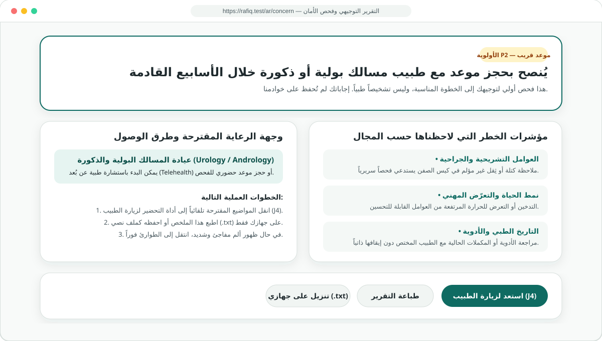
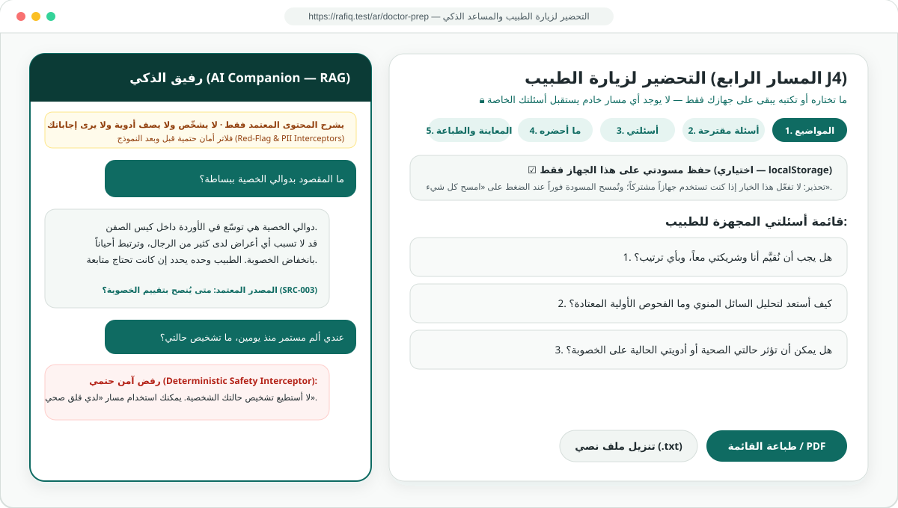
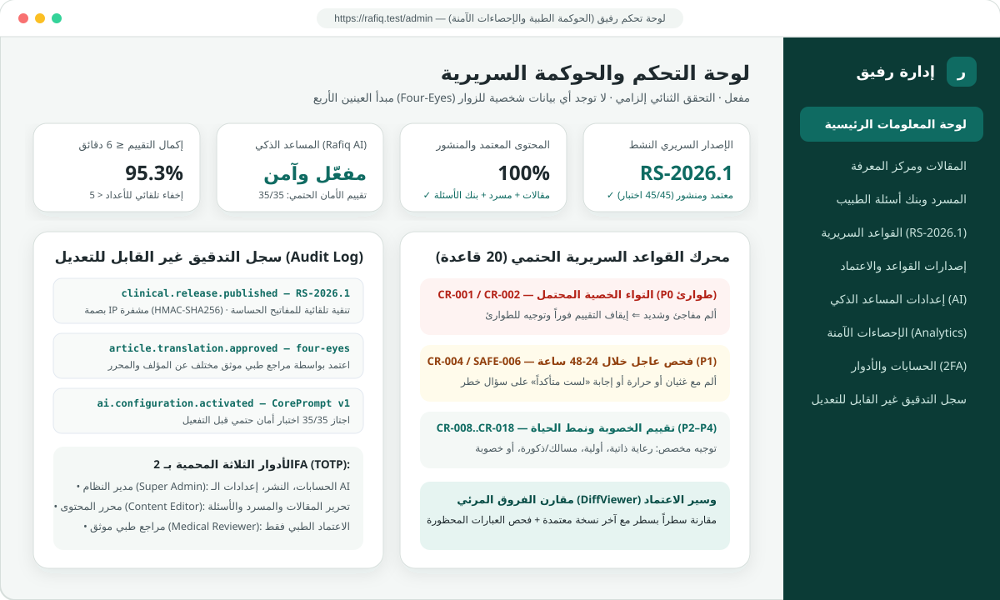
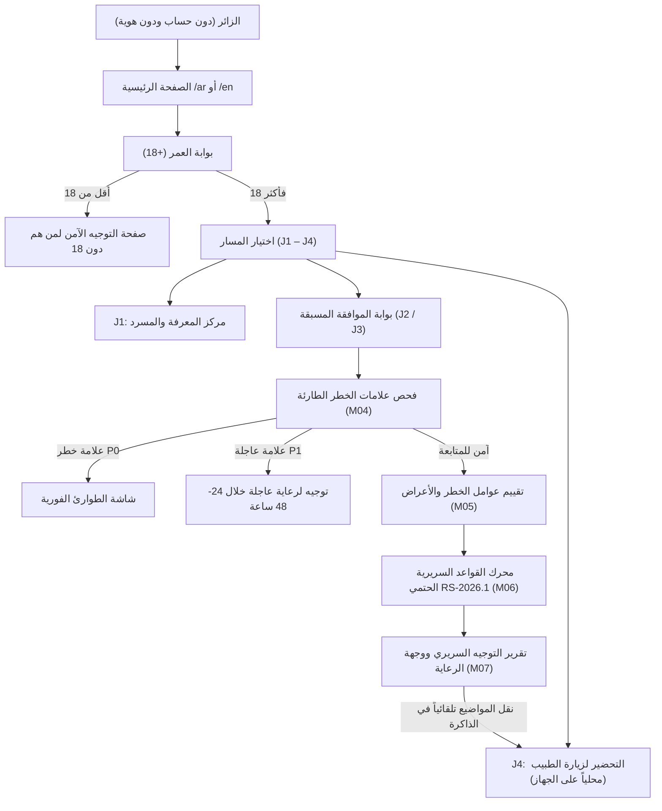

<div align="center" dir="rtl">

# رفيق | Rafiq

### منصّة التوعية والتوجيه السريري الآمن في صحة الرجل الإنجابية

[](https://www.php.net/)
[](https://laravel.com)
[](https://inertiajs.com)
[](https://tailwindcss.com)
[](#الأوامر-البرمجية-واختبارات-الجودة)
[](#محرك-القواعد-السريرية-الحتمي)
[](#المساعد-الذكي-المقيّد-rafiq-ai-companion)

</div>

---

## نبذة عن المشروع (Overview)

**رفيق (Rafiq)** هي منصّة رقمية ثنائية اللغة (**العربية RTL** و**الإنجليزية LTR**) مصمّمة لمساعدة الرجال والأزواج على فهم صحتهم الإنجابية، واكتشاف مؤشرات الخطر مبكراً، ومعرفة خطوتهم الصحية التالية بثقة، والاستعداد لزيارة الطبيب — **دون الحاجة إلى إنشاء حساب، ودون طلب أي بيانات تعريفية، ودون حفظ أي إجابات صحية على الخادم**.

> **تنبيه سريري أساسي:** منصّة رفيق أداة توعية وفحص أولي وتوجيه للرعاية الصحية المناسبة (**Screening & Care Navigation**)، وليست أداة تشخيص طبي ولا تصف أدوية أو علاجات ولا تغني عن استشارة الطبيب المختص.

---

## صور وواجهات المشروع (Project Screenshots)

### 1. الصفحة الرئيسية والرحلات الأربع (Landing Page & Four Journeys)


### 2. فحص الأمان والتقرير التوجيهي السريري (Clinical Guidance Report & Risk Domains)


### 3. أداة التحضير لزيارة الطبيب والمساعد الذكي (Doctor Visit Prep & Rafiq AI Companion)


### 4. لوحة التحكم والحوكمة الطبية (Admin Dashboard & Four-Eyes Governance)


---

## المسارات الأربعة في رفيق (The Four User Journeys)

| المسار | الرابط | الهدف | ما نسأله للمستخدم |
|---|---|---|---|
| **J1 — أريد أن أتعلّم** (`Learn`) | `/ar/learn` | تصفح مركز المعرفة الموثّق، البحث الفوري، ومسرد المصطلحات الطبية | لا نسأل أي سؤال؛ قراءة وتصفح حر بعد تأكيد العمر (+18). |
| **J2 — لدي قلق أو عرض صحي** (`Concern`) | `/ar/concern` | فحص علامات الخطر الطارئة (`P0`/`P1`) أولاً ثم تقييم الأعراض وتوجيه المستخدم لوجهة الرعاية | أسئلة اختيارية مغلقة في ذاكرة المتصفح فقط دون أي نص حر ودون حفظ في قاعدة البيانات. |
| **J3 — أستعد للإنجاب / تأخر حمل** (`Conception`) | `/ar/conception` | تقييم عوامل الخطر المرتبطة بالخصوبة (التاريخ الطبي، نمط الحياة، العوامل التشريحية والأيضية) | فحص أمان مختصر يتبعه استبيان عوامل الخطر للزوجين وتقرير توجيهي مفصّل. |
| **J4 — التحضير لزيارة الطبيب** (`Doctor Prep`) | `/ar/doctor-prep` | بناء قائمة أسئلة منظمة للطبيب وقائمة ما يُحضر للعيادة للطباعة أو التنزيل (`.txt`) | يعمل بالكامل على جهاز المستخدم فقط؛ لا يوجد أي مسار خادم يستقبل أسئلة الزائر الخاصة. |



---

## أبرز المميزات والضمانات المعمارية (Key Architectural Guarantees)

### 1. الخصوصية بالتصميم (Privacy by Design — Zero Stored PHI)
- **لا حسابات للزوار ولا بيانات تعريفية:** لا يطلب النظام اسماً أو بريداً إلكترونياً أو رقم هاتف أو تاريخ ميلاد.
- **عدم تخزين الإجابات الصحية:** تُرسل رموز الإجابات المغلقة فقط لحساب نتيجة القواعد السريرية لحظياً ثم تُتلف فوراً؛ ويضمن اختبار `LaunchReadinessTest` آلياً عدم وجود أي عمود في قاعدة البيانات يحفظ إجابات أو أعراض أو رسائل الزوار أو عناوين IP الخام.
- **زر «امسح كل شيء» (`Clear Everything`):** ينهي الجلسة، يدوّر رمز الحماية `CSRF`، ويمسح ذاكرة المتصفح المؤقتة وتاريخ التنقل داخل المنصّة بضغطة واحدة.

### 2. محرك القواعد السريرية الحتمي (Deterministic Clinical Rules Engine — `RS-2026.1`)
- التوجيه الطبي والأولويات (`P0` طوارئ فورية ← `P4` تثقيف ورعاية ذاتية) يُحسَب **حصرياً عبر محرك قواعد حتمي (`ClinicalRulesEngine`)** وليس عبر الذكاء الاصطناعي.
- يضم الإصدار المعتمد `RS-2026.1` **20 قاعدة سريرية** تغطي علامات الخطر، التاريخ الطبي والجراحي، الأدوية والستيرويدات، العوامل التشريحية، العوامل الأيضية والمُعدية، ونمط الحياة، مع **45 حالة اختبار سريرية قياسية (`TC-01..TC-45`)**.
- يحدد المحرك لكل حالة **وجهة الرعاية الأنسب (`CarePathway`)**: رعاية طوارئ، عيادة مسالك بولية/ذكورة، خدمات خصوبة، رعاية أولية، أو رعاية ذاتية، مع توضيح خيارات البدء عن بُعد (`Telehealth`) لتقليل الزيارات غير الضرورية.

### 3. المساعد الذكي المقيّد بالمحتوى المعتمد (Grounded AI Companion — RAG)
- يعمل المساعد الذكي على مقاطع المحتوى المعتمد طبياً فقط (`ContentChunk` — RAG).
- **فلاتر أمان حتمية قبل وبعد النموذج (`RedFlagInterceptor`, `InputPreFilter`, `OutputPostFilter`):**
  - أي رسالة تذكر عرضاً طارئاً (مثل ألم خصية مفاجئ وشديد) تُعترَض حتمياً قبل استدعاء النموذج وتُحوَّل فوراً لتنبيه الطوارئ.
  - أي سؤال يطلب تشخيصاً لحالة شخصية أو وصف دواء أو جرعة يُرفَض بأمان ويُوجَّه إلى مسار التقييم السريري.
  - لا تصل إجابات التقييم الصحي للمساعد الذكي أبداً.

### 4. لوحة التحكم والحوكمة الطبية بمبدأ العينين الأربع (Admin & Four-Eyes Governance)
- **التحقق الثنائي الإلزامي (Mandatory TOTP 2FA):** كل حساب إداري ملزم بتفعيل التحقق الثنائي (RFC 6238 TOTP + 8 أكواد استرداد مشفرة).
- **ثلاثة أدوار مفصولة الصلاحيات (RBAC):**
  - `Super Admin` (مدير النظام)
  - `Content Editor` (محرر المحتوى)
  - `Medical Reviewer` (مراجع طبي موثّق بمرجع ترخيص مهني `credential_reference`)
- **بوابة العينين الأربع (`four-eyes`):** لا يُنشر أي مقال أو مصطلح أو سؤال طبيب أو قاعدة سريرية إلا بعد اعتماده من مراجع طبي موثّق **مختلف** عن مؤلف العنصر وآخر محرر له (حتى لو كان المؤلف يحمل صلاحية `Super Admin`).
- **مقارن الفروق المرئي (`DiffViewer`) وفحص العبارات المحظورة (`ForbiddenPhraseChecker`):** يمنع النظام آلياً حفظ أي صياغة تشخيصية أو علاجية محظورة.
- **سجل تدقيق غير قابل للتعديل (`Immutable Audit Log`):** يسجل كل عملية حساسة مع بصمة IP مشفرة (`HMAC-SHA256`) وتنقية تلقائية لأي مفاتيح حساسة.
- **إحصاءات آمنة للخصوصية (`Privacy-Safe Analytics`):** تعرض مؤشرات الأداء والعدالة مع إخفاء تلقائي على الخادم لأي عدّاد قيمته بين `1` و`4` (`< 5`).

---

## التقنيات المستخدمة (Tech Stack)

- **الواجهة الخلفية (Backend):** PHP 8.3+ · Laravel 12
- **الواجهة الأمامية (Frontend):** React 19 · TypeScript · Inertia.js v3 · Tailwind CSS v4 · Lucide Icons
- **قاعدة البيانات (Database):** MySQL 8.0+ (للإنتاج والتطوير) · SQLite (لاختبارات الذاكرة السريعة)
- **الذكاء الاصطناعي (AI Integration):** Google Gemini API (`generateContent` مع JSON Schema صارم + موفر `fake` محلي آمن للتجربة والاختبار دون اتصال)
- **الجودة والفحص الآلي (Tooling):** PHPUnit 12 · Laravel Pint · ESLint · TypeScript (`tsc`) · Prettier · GitHub Actions CI

---

## طريقة التحميل والتشغيل (Installation & Setup Guide)

### 1. المتطلبات الأساسية (Prerequisites)
تأكد من توفر الأدوات التالية على جهازك (مثل بيئة **Laragon** أو **Laravel Herd** أو **Docker**):
- **PHP** `>= 8.3` (مع امتدادات `pdo_mysql`, `pdo_sqlite`, `mbstring`, `openssl`, `intl`, `curl`)
- **Composer** `>= 2.x`
- **Node.js** `>= 20.x` و **npm**
- **MySQL** `>= 8.0` (أو SQLite للتشغيل السريع)

### 2. استنساخ المستودع وتثبيت الحزم (Clone & Install Dependencies)

```bash
# 1. استنساخ المشروع والدخول إلى المجلد
git clone <repository-url> rafiq
cd rafiq

# 2. تثبيت حزم PHP عبر Composer
composer install

# 3. تثبيت حزم الواجهة الأمامية عبر npm
npm install
```

### 3. إعداد ملف البيئة ومفتاح التطبيق (Environment Setup)

```bash
# نسخ ملف البيئة الافتراضي
cp .env.example .env

# توليد مفتاح تشفير التطبيق
php artisan key:generate
```

افتح ملف `.env` وتأكد من إعدادات قاعدة البيانات (الافتراضي مناسب لـ Laragon):
```env
DB_CONNECTION=mysql
DB_HOST=127.0.0.1
DB_PORT=3306
DB_DATABASE=rafiq
DB_USERNAME=root
DB_PASSWORD=

# وضع التشغيل المعتمد (false = المحتوى والقواعد معتمدة ومنشورة دون شريط تجريبي)
RAFIQ_DEMO_MODE=false
RAFIQ_ASSESSMENT_ENABLED=true
RAFIQ_AI_ENABLED=true

# لتشغيل المساعد الذكي محلياً فوراً دون الحاجة لمفتاح خارجي اتركه fake
# أو غيّره إلى gemini وضع مفتاح Google Gemini الحقيقي في GEMINI_API_KEY
RAFIQ_AI_PROVIDER=fake
GEMINI_API_KEY=
GEMINI_MODEL=gemini-2.5-flash
```

### 4. تشغيل التهجيرات وبذر البيانات المعتمدة (Migrate & Seed)

يقوم أمر البذر بإنشاء الأدوار والحسابات التجريبية، واستيراد مقالات مركز المعرفة، ومسرد المصطلحات، وبنك أسئلة زيارة الطبيب، والإصدار السريري `RS-2026.1`، ثم **اعتمادها ونشرها طبياً بالكامل**:

```bash
php artisan migrate --seed
```

*(ويمكنك في أي وقت إعادة اعتماد ونشر كل المحتوى والقواعد بأمر واحد: `php artisan rafiq:approve-all`).*

### 5. بناء الواجهة الأمامية وتشغيل الخادم (Build & Serve)

```bash
# لبناء أصول الإنتاج
npm run build

# لتشغيل خادم التطوير المتكامل (Laravel + Queue + Vite)
composer run dev
```

أو لتشغيل خادم Laravel منفرداً:
```bash
php artisan serve
```

ثم افتح المتصفح على:
- **الواجهة العامة (العربية):** `http://localhost:8000/ar` (أو `http://rafiq.test/ar` على Laragon)
- **الواجهة العامة (الإنجليزية):** `http://localhost:8000/en`
- **لوحة التحكم (Admin):** `http://localhost:8000/admin/login`

---

## حسابات لوحة التحكم التجريبية والدخول (Demo Admin Credentials)

بعد تشغيل `php artisan db:seed` في البيئة المحلية (`local`)، تتوفر الحسابات التالية للتجربة الفورية:

| الدور | البريد الإلكتروني | كلمة المرور | الصلاحيات الرئيسية |
|---|---|---|---|
| **مدير النظام (`Super Admin`)** | `admin@rafiq.test` | `Password1234!` | إدارة الحسابات والأدوار، نشر إصدارات القواعد، إعدادات وميزانية الـ AI، سجل التدقيق الكامل |
| **محرر المحتوى (`Content Editor`)** | `editor@rafiq.test` | `Password1234!` | إنشاء وتحرير المقالات، التصنيفات، المصادر، المسرد، بنك أسئلة الطبيب، ونصوص الإرشاد |
| **مراجع طبي موثّق (`Medical Reviewer`)** | `reviewer@rafiq.test` | `Password1234!` | تشغيل اختبارات القواعد، المراجعة والاعتماد الطبي بمبدأ العينين الأربع، عرض سجل تدقيق المراجعات |

### خطوة التحقق الثنائي (2FA) عند الدخول للوحة التحكم:
بعد إدخال البريد وكلمة المرور في `/admin/login`:
1. **الدخول السريع بأكواد الاسترداد الجاهزة:** أدخل أياً من الأكواد التالية في حقل الرمز:
   `DEMO-0001` · `DEMO-0002` · `DEMO-0003` · `DEMO-0004` · `DEMO-0005` · `DEMO-0006` · `DEMO-0007` · `DEMO-0008`
   *(يُستهلك الرمز بعد استخدامه؛ ولإعادة توليد الأكواد الـ 8 شغّل: `php artisan db:seed --class=AdminSeeder`).*
2. **أو عبر تطبيق المصادقة (Google Authenticator / Authy):** المفتاح السري الموحد للحسابات التجريبية هو:
   `JBSWY3DPEHPK3PXPJBSWY3DPEHPK3PXP`

---

## الأوامر البرمجية واختبارات الجودة (CLI Commands & Testing)

```bash
# تشغيل كامل حزمة اختبارات PHPUnit (337 اختباراً)
php artisan test --compact

# تشغيل حالات الاختبار السريرية القياسية (45 حالة) على الإصدار RS-2026.1
php artisan rafiq:clinical:test RS-2026.1 --files

# تشغيل تقييم الأمان الحتمي للمساعد الذكي (35 حالة أمان)
php artisan rafiq:ai:eval safety

# محاكاة 2000 زائر اصطناعي لحساب توزيع وجهات الرعاية ومؤشرات الخطر
php artisan rafiq:simulate --count=2000 --seed=2026

# اعتماد ونشر جميع المقالات والمسرد وبنك الأسئلة والإصدار السريري RS-2026.1
php artisan rafiq:approve-all

# إنشاء حساب مدير عام (Super Admin) جديد عبر سطر الأوامر
php artisan rafiq:admin:create --name="Admin" --email="root@rafiq.test" --password="StrongPassword123!" --locale=ar

# فحص الاتصال الحي بـ Google Gemini (عند ضبط RAFIQ_AI_PROVIDER=gemini)
php artisan rafiq:ai:ping

# تشغيل مهام الحذف المجدولة (حذف سجلات الاستخدام والتدقيق المنتهية)
php artisan rafiq:prune

# فحص جودة الكود (Pint + TypeScript + ESLint)
vendor/bin/pint --test
npm run typecheck
npm run lint
```

---

## هيكل المشروع ووثائق التصميم (Project Structure & Documentation)

```text
rafiq/
├── app/
│   ├── Console/Commands/       # أوامر CLI (الاستيراد، الاختبار السريري، تقييم الـ AI، المحاكاة، الحذف)
│   ├── Enums/                  # تعدادات المجال (Priority, CarePathway, RiskDomain, Journey, AdminRole...)
│   ├── Http/
│   │   ├── Controllers/Admin/  # متحكمات لوحة الإدارة (المصادقة، القواعد، المحتوى، الـ AI، الإحصاءات)
│   │   ├── Controllers/Public/ # متحكمات الزوار (Landing، المسارات، البوابات، التقييم، مركز المعرفة)
│   │   └── Middleware/         # بوابات العمر والموافقة، التحقق الثنائي 2FA، ترويسات الأمان واللغة
│   ├── Models/                 # نماذج Eloquent (مع منع التحميل الكسول ومنع تعديل سجل التدقيق)
│   ├── Policies/               # سياسات الصلاحيات ومصفوفة الأدوار
│   └── Services/
│       ├── Ai/                 # المساعد الذكي، فلاتر الأمان الحتمية، مسترجع المقاطع (RAG)، وتقييم الأمان
│       ├── Analytics/          # تسجيل وتقرير العدادات المجمّعة الآمنة مع إخفاء (< 5)
│       ├── Audit/              # خدمة سجل التدقيق مع تنقية المفاتيح الحساسة وتشفير بصمة IP
│       ├── Auth/               # خدمة التحقق الثنائي القياسية (RFC 6238 TOTP)
│       ├── Clinical/           # محرك القواعد السريرية الحتمي، مقيّم الشروط، وفاحص العبارات المحظورة
│       └── Content/            # سير عمل المقالات وبنوك النصوص، معالج Markdown، ومُقطّع الـ RAG
├── database/
│   ├── migrations/             # تهجيرات قاعدة البيانات المفهرسة والمتوافقة مع MySQL 8 وSQLite
│   └── seeders/                # بواذر البيانات التجريبية واعتماد المحتوى والقواعد (ApproveAllContentSeeder)
├── docs/                       # التوثيق الهندسي والسريري الشامل للمشروع
│   ├── 00-overview/            # ملخص المشروع وفهرس التوثيق
│   ├── 01-product/             # وثيقة متطلبات المنتج (PRD)، رحلات المستخدم، ومواصفات التصميم
│   ├── 02-architecture/        # معمارية النظام، تصميم قاعدة البيانات، الأمن، والخصوصية
│   ├── 03-modules/             # المواصفات التفصيلية وملاحظات التنفيذ للوحدات (Module-00 .. Module-12)
│   ├── 04-clinical/            # إطار السلامة السريرية، كتالوج القواعد، وسير الاعتماد الطبي
│   ├── 05-ai/                  # حوكمة الذكاء الاصطناعي، تكامل Gemini، وهندسة الأوامر
│   └── screenshots/            # صور ومعاينات واجهات المشروع
├── lang/                       # قواميس الترجمة الكاملة (ar.json و en.json — أكثر من 1130 مفتاحاً لكل لغة)
├── resources/
│   ├── clinical/               # ملفات القواعد السريرية (RS-2026.1)، حالات الاختبار، والعبارات المحظورة
│   ├── ai-eval/                # حالات اختبار الأمان الحتمي للمساعد الذكي (safety.jsonl)
│   └── js/                     # تطبيق React 19 + Inertia v3 + Tailwind CSS v4
└── tests/                      # 337 اختباراً آلياً (Feature & Unit) تغطي كل متطلبات السلامة والخصوصية
```

---

## الترخيص (License)

هذا المشروع مرخّص تحت رخصة [MIT License](https://opensource.org/licenses/MIT).
