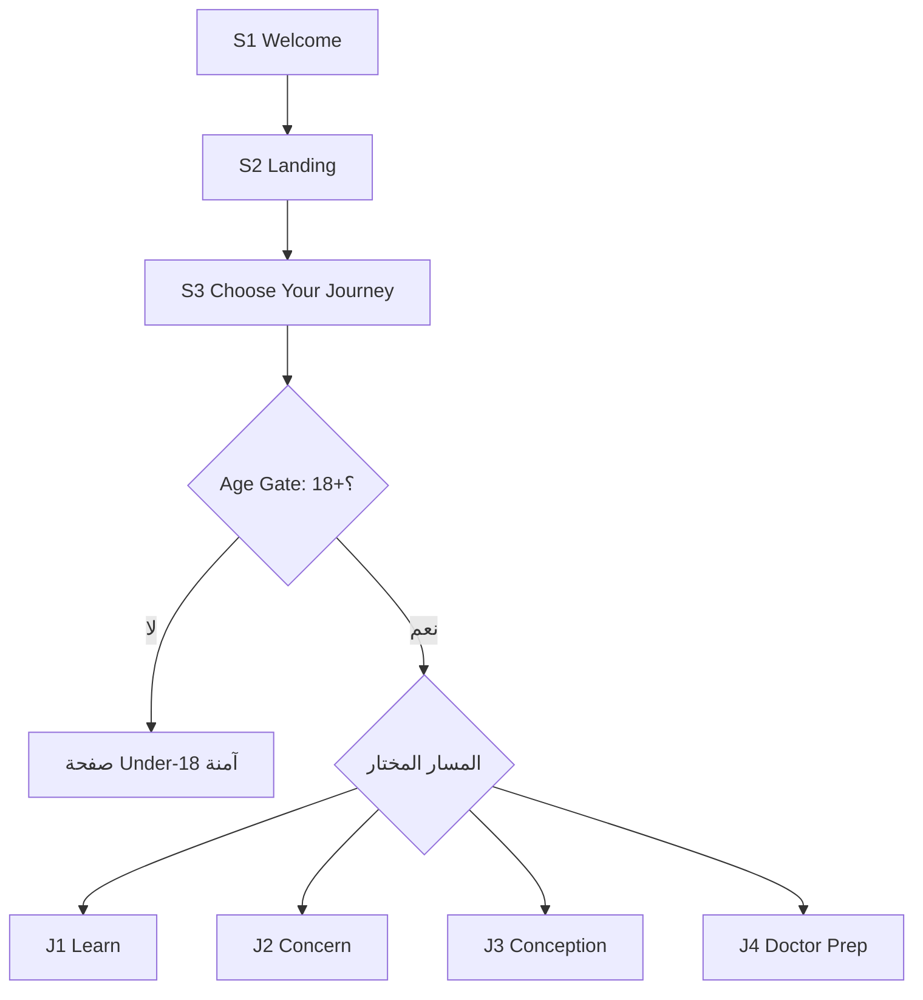
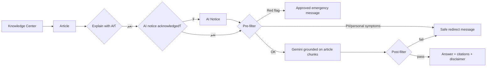
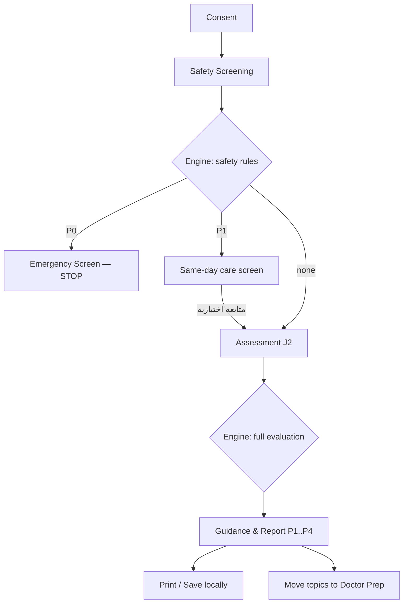
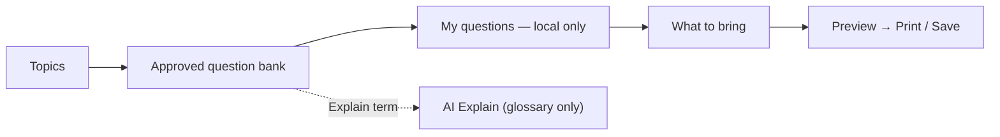

# رحلات المستخدم (User Journeys)

> الحالة: Draft · آخر تحديث: 2026-11-15
> **DRAFT – PENDING QUALIFIED MEDICAL REVIEW** — تتضمن هذه الوثيقة إشارات إلى نتائج قواعد سريرية غير معتمدة.

## 0. المراحل المشتركة

| المرحلة | الوصف | Module |
|---|---|---|
| S1 Welcome | شاشة ترحيب قصيرة (FR-001) | M01 |
| S2 Landing | ما هو رفيق، كيف يعمل، الخصوصية، دور AI، الحدود، المسارات (FR-002..004) | M01 |
| S3 Choose Your Journey | J1–J4 (FR-010) | M02 |
| Gate | Age Gate 18+ مرة لكل جلسة (FR-020) + إشعارات حسب المسار (FR-021/022) | M03 |
| S4 Personalized Journey | تدفق مستقل لكل مسار | M04–M10 |

**عناصر ثابتة في كل الشاشات:** مبدّل اللغة (يحافظ على الموضع — L10N-003)، زر خروج سريع (FR-005)، رابط "علامات الخطر/الطوارئ"، التذييل (FR-100).

**قاعدة الانتقال بين المسارات:** لا تُنقل إجابات من مسار لآخر إلا "موضوعات للنقاش" من التقرير إلى J4 وبفعل صريح من المستخدم وداخل المتصفح فقط (FR-062).

---

## J1 — أريد أن أتعلّم (Learn)

**الهدف:** وصول سريع لمحتوى موثوق دون استبيان. **الشخصيات:** PER-01، PER-05.

| # | الخطوة | ما يراه المستخدم | النظام | متطلبات |
|---|---|---|---|---|
| 1 | يختار J1 | — | زيادة عداد `journey_selected:j1` | FR-014 |
| 2 | Age Gate (إن لم يُجتز في الجلسة) | سؤال واحد | تخزين `age_confirmed=true` في الجلسة | FR-020 |
| 3 | Knowledge Center Home | تصنيفات، مقالات مميزة، بحث، "أسئلة شائعة" | محتوى منشور باللغة النشطة فقط | FR-070 |
| 4 | يفتح مقالاً | النص، المصادر، تاريخ المراجعة، مقالات مرتبطة | — | FR-071 |
| 5 | (اختياري) "اشرح لي بالذكاء الاصطناعي" | إشعار AI أول مرة، ثم لوحة محادثة مقيدة بالمقال | M09 Explain mode | FR-022, FR-074, AI-002 |
| 6 | (اختياري) ينتقل لمسار آخر | بطاقات "هل لديك قلق محدد؟" / "تستعد للإنجاب؟" | — | FR-010 |

**حالات خاصة:**
- المقال غير متاح باللغة النشطة ⇒ رسالة + رابط للنسخة الأخرى (FR-072).
- يكتب في الـ AI "عندي ألم مفاجئ شديد" ⇒ مرشح علامات الخطر يعرض رسالة الطوارئ المعتمدة دون استدعاء Gemini (AI-012).
- يكتب أعراضاً شخصية غير طارئة ⇒ رد آمن: "لا أستطيع تقييم حالتك؛ جرّب مسار (لدي قلق صحي) أو تحدث مع طبيب" (AI-010).

---

## J2 — لدي قلق صحي (Concern)

**الهدف:** تحديد الأولوية والخطوة التالية بأمان. **الشخصية:** PER-02.

| # | الخطوة | ما يراه المستخدم | النظام | متطلبات |
|---|---|---|---|---|
| 1 | يختار J2 | — | عداد | FR-014 |
| 2 | Age Gate | — | — | FR-020 |
| 3 | إشعار خصوصية + موافقة | "إجاباتك لا تُحفظ لدينا…" + مربع موافقة | لا شيء يُخزَّن سوى `assessment_consent=true` في الجلسة | FR-021 |
| 4 | Safety Screening (≤ 6 أسئلة، نعم/لا/لست متأكداً) | سؤال لكل شاشة | الإجابات في React state | FR-030 |
| 5 | إرسال الفحص | — | `POST /{locale}/assessment/screen` ⇒ المحرك يقيّم قواعد السلامة فقط | FR-031 |
| 6a | **P0** | شاشة طوارئ كاملة: اتصل بالطوارئ/اذهب للطوارئ الآن، لا تقد بنفسك، أحضر قائمة أدويتك [مصدر: SRC-001] | المسار يتوقف | FR-032 |
| 6b | **P1** | "تحتاج تقييماً طبياً اليوم" + خيار متابعة القراءة | — | FR-033 |
| 6c | لا علامات خطر | انتقال لأسئلة التقييم | — | — |
| 7 | Assessment (J2 set) | أسئلة قابلة للتخطي مع "لماذا نسأل؟" | — | FR-040..045 |
| 8 | إرسال التقييم | — | `POST /{locale}/assessment/evaluate` — المحرك يعيد `priority`, `triggered_rules`, `guidance_keys`, `ruleset_version` — لا تخزين | FR-050, PRIV-004 |
| 9 | Guidance & Report | الأولوية بلغة بسيطة، الخطوة التالية، الأسباب، موضوعات للطبيب، محتوى مرتبط، الحدود | `Cache-Control: no-store` | FR-060, PRIV-008 |
| 10 | طباعة/حفظ محلي، أو "انقل إلى تحضير الطبيب" | — | لا طلبات شبكة | FR-061, FR-062 |
| 11 | "امسح كل شيء" | — | مسح الحالة وإنهاء الجلسة | PRIV-011 |

**حالات خاصة:**
- "لست متأكداً" على سؤال P0 ⇒ P1 + صندوق معايير الطوارئ (SAFE-006، بانتظار OQ-009).
- انقطاع الشبكة عند الإرسال ⇒ الإجابات تبقى في الذاكرة، زر "أعد المحاولة"، وتُعرض رسالة السلامة العامة SAFE-009.
- لا يوجد Ruleset معتمد (Production) ⇒ "الخدمة غير متاحة حالياً" + SAFE-009 + روابط J1.
- تحديث الصفحة (Refresh) ⇒ تُفقد الإجابات (مقصود) مع تنبيه `beforeunload` أثناء التقييم.

---

## J3 — أستعد للإنجاب (Conception)

**الهدف:** فهم متى قد يكون التقييم الطبي مناسباً، دون تشخيص العقم. **الشخصية:** PER-03.

| # | الخطوة | ما يراه المستخدم | النظام | متطلبات |
|---|---|---|---|---|
| 1–3 | اختيار، Age Gate، موافقة | — | — | FR-020, FR-021 |
| 4 | محتوى تمهيدي | "الاستعداد للإنجاب مسؤولية مشتركة" + 3 مقالات مقترحة | — | FR-070 |
| 5 | سؤال تمهيدي للسلامة | "هل لديك حالياً ألم أو تورم أو كتلة في الخصية؟" | "نعم/لست متأكداً" ⇒ Safety Screening الكامل (كما J2 خطوة 4–6) | FR-034 |
| 6 | أسئلة J3 | مدة المحاولة (نطاقات)، فحوص سابقة (نعم/لا/لا أعرف — دون قيم)، التاريخ الإنجابي، الأدوية/الستيرويدات، العلاج الكيميائي/الإشعاعي، التدخين، التعرض المهني، التاريخ العائلي، (اختياري) عمر الشريكة كنطاق (OQ-014) | — | FR-040, FR-042 |
| 7 | التقييم | — | المحرك (CR-006..CR-016) | FR-050 |
| 8 | الإرشاد | مثال: "مضى أكثر من 12 شهراً: يُنصح عادةً بتقييم طبي للطرفين معاً" [مصدر: SRC-003 — النص النهائي بانتظار المراجعة] | — | FR-060 |
| 9 | محتوى الاستعداد + Doctor Prep | مقالات نمط الحياة؛ نقل الموضوعات إلى J4 | — | FR-062 |

**ممنوع في J3 (SAFE-010, FR-063):** "خصوبتك طبيعية"، "احتمال الحمل X%"، "لديك عقم"، أي Score.

**حالة خاصة:** علاج كيميائي/إشعاعي **مخطط** ⇒ إرشاد زمني الحساسية: "ناقش خيارات حفظ الخصوبة مع فريقك العلاجي قبل بدء العلاج" [مصدر: SRC-003 يوصي بعرض حفظ السائل المنوي بالتجميد قبل العلاج السام للغدد — الصياغة والأولوية بانتظار المراجعة].

---

## J4 — أريد التحضير لموعد طبي (Doctor Visit Preparation)

**الهدف:** قائمة منظمة قابلة للطباعة، دون تفسير طبي. **الشخصية:** PER-04.

| # | الخطوة | ما يراه المستخدم | النظام | متطلبات |
|---|---|---|---|---|
| 1–2 | اختيار، Age Gate | — | — | FR-020 |
| 3 | تنبيه خصوصية خاص | "ما تكتبه هنا يبقى على جهازك ولا يُرسل لأي خادم" | — | FR-092 |
| 4 | اختيار الموضوعات | قائمة معتمدة (مثل: ألم/تورم، الاستعداد للإنجاب، الأدوية والستيرويدات، نتائج فحوص سابقة، الصحة الجنسية/البولية) | محتوى عام من الخادم (GET) | FR-090 |
| 5 | بنك الأسئلة | أسئلة معتمدة لكل موضوع بالإضافة/الحذف/الترتيب | — | FR-091 |
| 6 | أسئلتي الخاصة | حقول نص حرة — **محلية فقط** | لا طلبات شبكة | FR-092 |
| 7 | ما يجب إحضاره | Checklist (قائمة أدوية، تقارير فحوص ورقية، تواريخ مهمة) | — | FR-093 |
| 8 | (اختياري) "اشرح هذا المصطلح" | لمصطلحات بنك الأسئلة فقط (مثل "تحليل السائل المنوي") عبر AI Explain mode على المسرد — لا نص المستخدم | M09 | AI-002 |
| 9 | المعاينة والطباعة/الحفظ | ورقة A4 مرتبة باللغة النشطة | توليد محلي | FR-094, L10N-014 |

**الفرق عن طلب الـ Brief الأصلي:** طلب الـ Brief أن يساعد الـ AI في ترتيب وصياغة أسئلة يكتبها المستخدم. هذا معلّق (FR-096/AI-022) لأن أسئلة المستخدم عن صحته تحتوي حتماً بيانات أعراض، وهو ما يتعارض مع حارس "لا تُرسل بيانات الأعراض إلى Gemini". البدائل في [AI-Use-Cases](../06-ai/AI-Use-Cases.md) §UC-05 والقرار في OQ-005.

---

## مصفوفة المسارات × المكونات

| المكوّن | J1 | J2 | J3 | J4 |
|---|---|---|---|---|
| Age Gate | ✓ | ✓ | ✓ | ✓ |
| موافقة معالجة بيانات صحية مؤقتة | — | ✓ | ✓ | — (لا شيء يُرسل) |
| Safety Screening | — (رابط دائم) | ✓ كامل | ✓ مختصر ⇒ كامل عند الحاجة | تذكير ثابت |
| Rules Engine | — | ✓ | ✓ | — |
| Knowledge Center | ✓ أساسي | مرتبط | ✓ تمهيدي | — |
| AI Companion | ✓ | ✓ (عام فقط) | ✓ (عام فقط) | ✓ (مصطلحات فقط) |
| Report / Print | — | ✓ | ✓ | ✓ |
