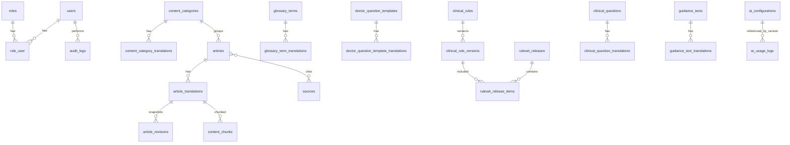

# تصميم قاعدة البيانات المبدئي (Database Design)

> الحالة: Draft (تصميم مبدئي — لا migrations في هذه المرحلة) · آخر تحديث: 2026-11-15 · المحرك المقترح: MySQL 8.4 (ADR-002)، `utf8mb4`.

## 1. المبادئ

1. **لا جداول لبيانات المستخدمين العامّين**: لا إجابات، لا نتائج، لا تقارير، لا محادثات AI، لا معرّفات زوار (DATA-002، ADR-003).
2. كل جدول له غرض ومدة احتفاظ في [Data-Inventory](../05-privacy/Data-Inventory.md).
3. المحتوى والقواعد **مُصدَّرة**؛ لا حذف صلب لما نُشر (أرشفة/تقاعد).
4. الترجمات في جداول `*_translations` مع `locale` وحالة مراجعة مستقلة لكل لغة (L10N-009).
5. كل FK بقيود صريحة وفهارس للاستعلامات العامة (`locale`, `status`).

## 2. مخطط العلاقات (ERD مختصر)

## 3. الجداول

### 3.1 الإدارة والصلاحيات

**`users`** (موجود — يُعاد استخدامه لحسابات الأدمن فقط؛ ADR-012)
| العمود | النوع | ملاحظات |
|---|---|---|
| id | bigint PK | |
| name | string | اسم الأدمن (بيانات موظف، ليست بيانات مستخدم عام) |
| email | string unique | |
| password | string | hashed |
| two_factor_secret, two_factor_recovery_codes, two_factor_confirmed_at | text/timestamp | Fortify، مشفرة |
| preferred_locale | enum(ar,en) | لغة لوحة الإدارة |
| is_active | bool | التعطيل بدلاً من الحذف |
| last_login_at | timestamp null | |
| timestamps | | |

> جدول `password_reset_tokens` يبقى للأدمن. جدول `sessions` الافتراضي **لا يُستخدم** إذا اعتُمد Redis/file (ADR-004)؛ وإن بقي `database` driver يُعدَّل لحذف `ip_address`/`user_agent` مع معالج مخصص.

**`roles`**: `id`, `key` (super_admin|content_editor|medical_reviewer) unique, timestamps.

**`role_user`**: `user_id` FK, `role_id` FK, `granted_by` FK users, `granted_at`, `credential_verified_at` null (إلزامي لـ medical_reviewer — ADM-003), `credential_reference` string null (مرجع خارجي مختصر، ليس صورة رخصة), `revoked_at` null. PK مركب (`user_id`, `role_id`).

**`audit_logs`**
| العمود | النوع | ملاحظات |
|---|---|---|
| id | bigint PK | |
| actor_id | FK users null | null للعمليات النظامية |
| action | string(64) | مثل `article.translation.approved`, `ruleset.published`, `role.granted`, `auth.login` |
| subject_type, subject_id | morph | |
| summary | json | الحقول المتغيرة (قيم قبل/بعد مختصرة) — لا أسرار، لا كلمات مرور |
| ip_hash | char(64) null | لعمليات الأدمن الأمنية فقط (HMAC مع مفتاح، لا IP خام) — OQ-013 |
| created_at | timestamp | لا `updated_at`؛ لا تعديل/حذف من الواجهة |

فهارس: (`subject_type`,`subject_id`), (`actor_id`,`created_at`), (`action`,`created_at`).

### 3.2 المحتوى والمعرفة

**`content_categories`**: `id`, `key` unique, `sort_order`, `is_visible`, `ai_enabled` bool, timestamps.
**`content_category_translations`**: `id`, `content_category_id` FK, `locale`, `name`, `slug`, `description`; unique (`locale`,`slug`), unique (`content_category_id`,`locale`).

**`articles`**
| العمود | النوع | ملاحظات |
|---|---|---|
| id | bigint PK | |
| content_category_id | FK | |
| key | string unique | معرف ثابت لغوياً محايد (يربط ترجمات اللغة) |
| kind | enum(article, faq, platform_guide, journey_intro) | `platform_guide` يغذي AI-001 |
| ai_enabled | bool default false | |
| sort_order | int | |
| created_by | FK users | |
| timestamps, soft deletes **غير مستخدم** (أرشفة عبر الحالة) | | |

**`article_translations`**
| العمود | النوع | ملاحظات |
|---|---|---|
| id | bigint PK | |
| article_id | FK | |
| locale | enum(ar,en) | unique (`article_id`,`locale`) |
| title, slug, summary | string/text | unique (`locale`,`slug`) |
| body_markdown | mediumText | المصدر |
| body_html | mediumText | ناتج مُعقّم (ADR-017) |
| review_status | enum ReviewStatus | `draft`→`pending_medical_review`→`approved`/(رفض⇒`draft`)→`retired` |
| publish_status | enum PublishStatus | `published` يتطلب `review_status=approved` |
| version | int | يزيد عند كل اعتماد |
| author_id | FK users | |
| medically_approved_by | FK users null | ≠ author_id (SAFE-003) |
| medically_approved_at | timestamp null | |
| review_due_at | date null | افتراضياً +12 شهراً (SAFE-013) |
| published_at | timestamp null | |
| timestamps | | |
فهرس FULLTEXT (`title`,`summary`) بمحلل ngram للبحث العام.

**`article_revisions`**: `id`, `article_translation_id` FK, `version`, `title`, `body_markdown`, `approved_by`, `approved_at`, `change_note`, `created_at`. (سجل غير قابل للتعديل لما اعتُمد.)

**`sources`**: `id`, `title`, `publisher`, `url`, `publication_date` null, `last_updated_date` null, `accessed_at` date, `evidence_type` enum(clinical_guideline, public_health_body, peer_reviewed, other), `access_note` (مثل "full text behind login"), `ai_use_restricted` bool (مثل AUA — لا يُغذّى للـ AI), timestamps.

**`article_source`**: `article_id`, `source_id`, `claim_note` text null, `support_level` enum(direct, inference, needs_review).

**`content_chunks`**: `id`, `article_translation_id` FK, `locale`, `chunk_index`, `heading` null, `text` text, `token_estimate` int, `created_at`. فهرس FULLTEXT (`text`) ngram. يُعاد توليدها عند كل نشر ويُحذف القديم.

**`glossary_terms`** / **`glossary_term_translations`**: `term`, `definition_markdown`, `definition_html`, نفس حقول المراجعة والنشر كالمقالات.

**`doctor_question_templates`**: `id`, `topic_key`, `sort_order`, `is_active`. **`doctor_question_template_translations`**: `locale`, `question_text`, `helper_text` null، حقول المراجعة. (FR-091)

### 3.3 القواعد السريرية

**`ruleset_releases`**
| العمود | النوع | ملاحظات |
|---|---|---|
| id | PK | |
| version | string unique | مثل `RS-2026.1` |
| status | enum(draft, pending_medical_review, approved, published, superseded, retired) | |
| source_hash | char(64) | hash لملفات JSON المستوردة |
| test_report | json | نتيجة تشغيل حالات الاختبار (SAFE-008) |
| tests_passed_at | timestamp null | |
| medically_approved_by / at | FK / timestamp | |
| published_by / at | FK / timestamp | Super Admin |
| notes | text | |

**`clinical_questions`**: `id`, `ruleset_release_id` FK, `key` (مثل `ss_sudden_severe_pain`), `section` enum(safety, assessment), `journeys` json (`["concern","conception"]`), `type` enum(boolean_unsure, single, multi, band), `options` json, `required` bool, `unsure_allowed` bool, `show_if` json null, `sort_order`. unique (`ruleset_release_id`,`key`).
**`clinical_question_translations`**: `clinical_question_id`, `locale`, `prompt`, `why_we_ask`, `option_labels` json، حقول المراجعة.

**`clinical_rules`**: `id`, `code` unique (CR-001…), `title`, `created_at`.

**`clinical_rule_versions`**
| العمود | النوع | ملاحظات |
|---|---|---|
| id | PK | |
| clinical_rule_id | FK | |
| version | int | unique (`clinical_rule_id`,`version`) |
| definition | json | conditions + priority + guidance_keys + stop (ADR-005) |
| priority | enum(P0..P4, GATE) | مكرر من definition للاستعلام |
| status | enum ReviewStatus | Draft / Pending Medical Review / Approved / Retired |
| evidence | json | [{source_id, support_level, note}] |
| rationale | text | |
| authored_by | FK users null | null عند الاستيراد الآلي؛ يُسجّل `imported_from_commit` |
| imported_from_commit | string null | |
| reviewed_by / reviewed_at / review_comment | | |
| retired_at | timestamp null | |

**`ruleset_release_items`**: `ruleset_release_id`, `clinical_rule_version_id`. PK مركب.

**`guidance_texts`**: `id`, `key` unique (مثل `guidance.p0.emergency.body`), `ruleset_release_id` null (أو عامة), `category` enum(priority_label, next_step, reason, doctor_topic, safety_general, under18). **`guidance_text_translations`**: `locale`, `text_markdown`, `text_html`، حقول المراجعة (SAFE-011).

### 3.4 الذكاء الاصطناعي

**`ai_configurations`**
| العمود | النوع | ملاحظات |
|---|---|---|
| id | PK | |
| version | int unique | |
| status | enum(draft, active, archived) | واحد فقط active |
| settings | json | welcome messages (ar/en)، suggested prompts، tone، default simplification level، allowed_category_ids، refusal messages، limits، daily_budget_usd، enabled |
| core_prompt_version | string | مرجع للثابت في الكود (للقراءة فقط) |
| model | string | |
| eval_report | json null | AI-020 |
| created_by / activated_by / activated_at | | |

**`ai_usage_logs`** (AI-017 — **بلا نص**)
| العمود | النوع |
|---|---|
| id | PK |
| created_at | timestamp (مقرّب للدقيقة) |
| mode | enum(platform_guide, explain_article, explain_term, general_education) |
| locale | enum |
| outcome | enum AiOutcome |
| ai_configuration_version | int |
| core_prompt_version | string |
| model | string null |
| input_tokens, output_tokens | int null |
| latency_ms | int null |
| error_code | string null |
| estimated_cost_micros | int null |
| article_id | FK null — مسموح لأنه يشير إلى محتوى عام (معرفة المقالات الأكثر طلباً للشرح) |

**ممنوع** في هذا الجدول: `ip`، `session_id`، `user_agent`، نص الرسالة أو الرد، المقاطع المسترجعة.

### 3.5 الإحصاءات

**`daily_metrics`**: `id`, `date`, `metric` string(64), `dimension` string(64) default '', `value` bigint. unique (`date`,`metric`,`dimension`).

| metric | dimension أمثلة |
|---|---|
| `page_view` | `landing`, `learn_index`, `article`, `doctor_prep` (نوع الصفحة فقط) |
| `journey_selected` | `learn`, `concern`, `conception`, `doctor_prep` |
| `locale_used` | `ar`, `en` |
| `age_gate` | `adult`, `under18` |
| `assessment_started` / `assessment_completed` | `concern`, `conception` |
| `report_printed` | `concern`, `conception`, `doctor_prep` (حدث من الواجهة بلا محتوى — Could) |
| `ai_request` | قيم `AiOutcome` |
| `article_ai_explain` | `article:{id}` |

**غير مسموح:** `priority`، `red_flag`، أي `question_key`/إجابة (OQ-010).

### 3.6 الجداول التشغيلية الموجودة
`cache`, `cache_locks`, `jobs`, `job_batches`, `failed_jobs` — تبقى. **قاعدة:** لا Jobs تحمل نصوص مستخدمين أو إجابات (لا تُوضع طلبات AI أو التقييم في الطابور).

## 4. ما لا يوجد عمداً

| غير موجود | السبب |
|---|---|
| `assessments`, `answers`, `reports` | ADR-003 |
| `ai_conversations`, `ai_messages` | AI-017، PRIV-004 |
| `visitors`, `public_sessions` | PRIV-002/005 |
| `uploads` للمستخدمين | FR-093 |

## 5. الاحتفاظ (ملخص — التفصيل في Data-Lifecycle)

| الجدول | الاحتفاظ |
|---|---|
| `ai_usage_logs` | 90 يوماً ثم تجميع إلى `daily_metrics` وحذف |
| `audit_logs` | 24 شهراً (مقترح — OQ-013) |
| `daily_metrics` | غير محدد (مجمّع، غير شخصي) |
| المحتوى/القواعد/الإصدارات | دائم (سجل سلامة) |
| `password_reset_tokens` | 60 دقيقة (افتراضي Laravel) |
| `failed_jobs` | 7 أيام |
