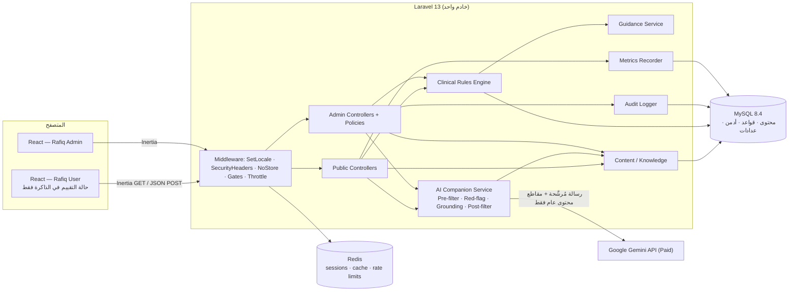
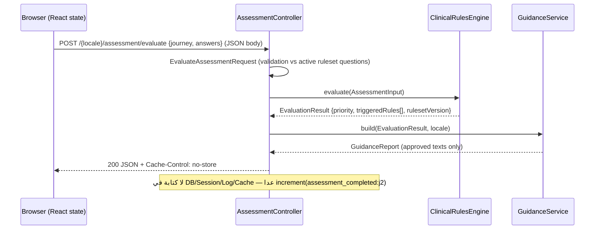
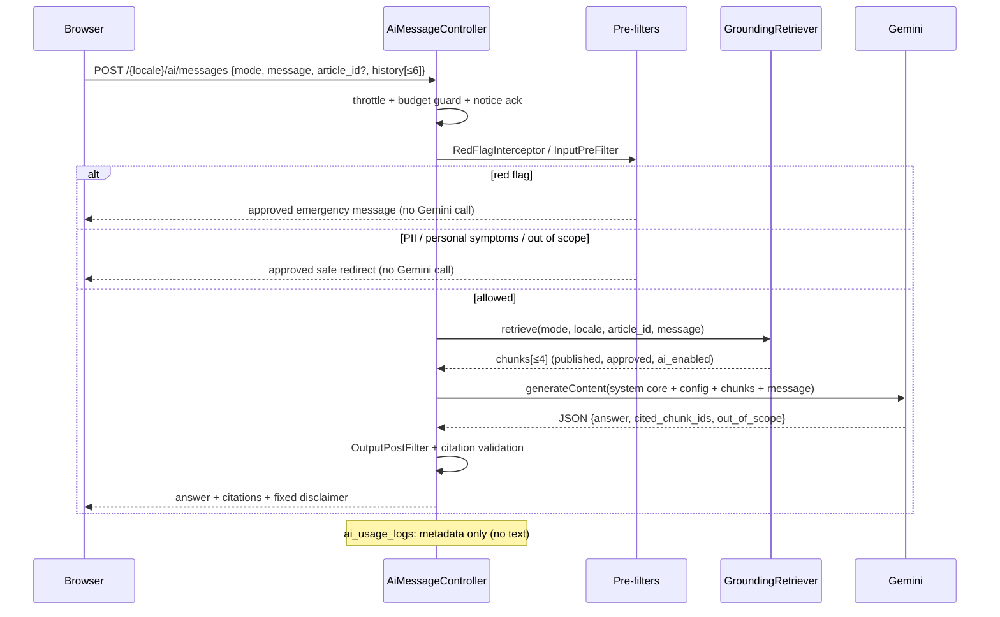

# البنية المعمارية للنظام (System Architecture)

> الحالة: Draft · آخر تحديث: 2026-11-15 · القرارات المرجعية: [Architecture-Decisions](Architecture-Decisions.md)

## 1. نظرة عامة

رفيق **Modular Monolith** واحد على Laravel 13، يخدم واجهتين عبر Inertia.js + React + TypeScript:

- **Rafiq User** — عام، بلا حساب، ثنائي اللغة بمسارات `/{locale}`.
- **Rafiq Admin** — تحت `/admin`، بمصادقة و2FA وأدوار.

## 2. المكونات ومسؤولياتها

| المكوّن | المسؤولية | ما لا يفعله | Module |
|---|---|---|---|
| **Public HTTP layer** | Controllers رفيعة، Form Requests، Inertia responses، JSON endpoints للتقييم والـ AI | لا منطق سريري | M01–M10 |
| **Locale & Gates** | `SetLocale`، `EnsureAgeConfirmed`، `EnsureAssessmentConsent`، `EnsureAiNoticeAcknowledged` | — | M00, M03 |
| **Clinical Rules Engine** (`App\Services\Clinical`) | تحميل Ruleset Release النشط، التحقق من المدخلات، تقييم الشروط، اختيار أعلى أولوية | لا تخزين، لا استدعاء AI، لا نصوص واجهة | M06 |
| **Guidance Service** (`App\Services\Guidance`) | تحويل `EvaluationResult` إلى نموذج تقرير (نصوص معتمدة باللغة، أسباب، موضوعات للطبيب، محتوى مرتبط) | لا يغيّر الأولوية | M07 |
| **Content / Knowledge** (`App\Services\Content`) | سير عمل المحتوى، التعقيم، توليد المقاطع، البحث | — | M08, M11 |
| **AI Companion** (`App\Services\Ai`) | المرشحات الحتمية، الاسترجاع، بناء الـ prompt، استدعاء Gemini، التحقق من المخرجات، سجل الاستخدام، السقف | لا يستقبل بيانات تقييم | M09 |
| **Admin** | CRUD + سير عمل الاعتماد + الإعدادات + RBAC + سجل التدقيق | لا عرض لبيانات مستخدمين | M11 |
| **Metrics** (`App\Services\Analytics`) | زيادة عدادات يومية مجمعة | لا أحداث فردية | M11 |
| **Scheduler** | تنظيف السجلات حسب الاحتفاظ، تنبيهات مراجعة المحتوى | — | M12 |

## 3. حدود الثقة (Trust Boundaries)

| # | الحد | ما يعبره | الضوابط |
|---|---|---|---|
| TB-1 | المتصفح ⇄ Laravel (عام) | طلبات GET للمحتوى؛ POST JSON للتقييم والـ AI | HTTPS، CSRF، Throttle، Form Requests، CSP، no-store |
| TB-2 | المتصفح ⇄ Laravel (Admin) | Inertia admin | Fortify + 2FA، Policies، جلسة قصيرة، تأكيد كلمة المرور للعمليات الحساسة |
| TB-3 | Laravel ⇄ Gemini | نص مُرشَّح + مقاطع عامة + تعليمات | مفتاح في `.env` فقط، لا PII، timeouts، مرشح مخرجات |
| TB-4 | Laravel ⇄ MySQL/Redis | بيانات غير صحية فقط | بيانات اعتماد منفصلة، شبكة خاصة في الإنتاج |
| TB-5 | Git ⇄ النظام | تعريفات القواعد | مراجعة كود، CI، استيراد بحالة Draft فقط |

## 4. تدفقات البيانات الرئيسية

### 4.1 تقييم (J2/J3)

### 4.2 رسالة AI

### 4.3 نشر محتوى
Editor يكتب ⇒ Submit ⇒ Medical Reviewer يعتمد الترجمة ⇒ Editor/Super Admin ينشر ⇒ `ArticlePublisher` يعقّم ويولّد `content_chunks` ويبطل الـ cache ⇒ Audit log.

### 4.4 نشر Ruleset
Developer يعدّل JSON في Git ⇒ CI يشغّل Clinical-Test-Cases ⇒ `rafiq:clinical:import` ⇒ إصدارات Draft ⇒ Submit ⇒ Medical Reviewer يعتمد كل قاعدة ⇒ إنشاء Release + تشغيل الاختبارات على الخادم وإرفاق التقرير ⇒ اعتماد طبي للإصدار + تأكيد Super Admin ⇒ Published (الإصدار السابق Superseded).

## 5. قرارات عرضية (Cross-cutting)

| الشأن | القرار | مرجع |
|---|---|---|
| اللغة | `/{locale}` + lang JSON + جداول ترجمة | ADR-011 |
| الجلسات | Redis/file، مشفرة، بلا IP/UA، 30 دقيقة | ADR-004 |
| الـ Cache | Redis؛ محتوى منشور مُخزن مؤقتاً لكل لغة؛ إبطال عند النشر | — |
| الطوابير | `database` queue (موجود) أو Redis؛ للاستخدام في توليد المقاطع والتنظيف فقط — **لا** طوابير لطلبات AI (متزامنة لتجنب تخزين النص في jobs table) | PRIV-004 |
| السجلات | `daily` channel، مستوى `warning` في الإنتاج، معالج يحذف مفاتيح `answers`/`message` من السياق | PRIV-009 |
| تتبع الأخطاء | إن استُخدمت خدمة خارجية (مثل Sentry) — `send_default_pii=false` وتعطيل إرسال أجسام الطلبات (OQ-025) | — |
| الأمن | [Security-Architecture](Security-Architecture.md) | — |
| الأداء | SSR غير مطلوب في الـ MVP (OQ-026: لتحسين SEO يمكن تفعيل Inertia SSR لاحقاً) | NFR-001 |

## 6. البيئات

| البيئة | الغرض | Demo Mode | Gemini | البيانات |
|---|---|---|---|---|
| local (Laragon) | تطوير | مسموح | مفتاح تطوير Paid أو Fake | اصطناعية |
| testing (CI) | اختبارات | مسموح | `Http::fake` دائماً | factories |
| staging/demo | عرض المسابقة | مسموح + شريط | Paid، سقف منخفض | اصطناعية |
| production | إطلاق عام | **ممنوع** | Paid أو Vertex | محتوى معتمد فقط |

الاستضافة: لم تُحدد (OQ-011). مهارة `deploying-to-cloud` المحلية تخص Laravel Cloud ويمكن استخدامها إن اختير؛ يجب التحقق من منطقة الاستضافة مقابل OQ-002 وقائمة مناطق Gemini المتاحة.

## 7. قابلية التوسع

- لغة ثالثة: إضافة locale إلى `config/rafiq.php`، ملف lang، وترجمات معتمدة — لا تغيير معماري.
- مسار جديد: تعريف `journey` جديد في Ruleset + صفحة React — المحرك عام.
- استرجاع دلالي: استبدال `GroundingRetriever` بتنفيذ embeddings خلف نفس الواجهة.
- مزوّد AI بديل: تنفيذ جديد لـ `AiTextGenerator` (مثل Vertex AI).
