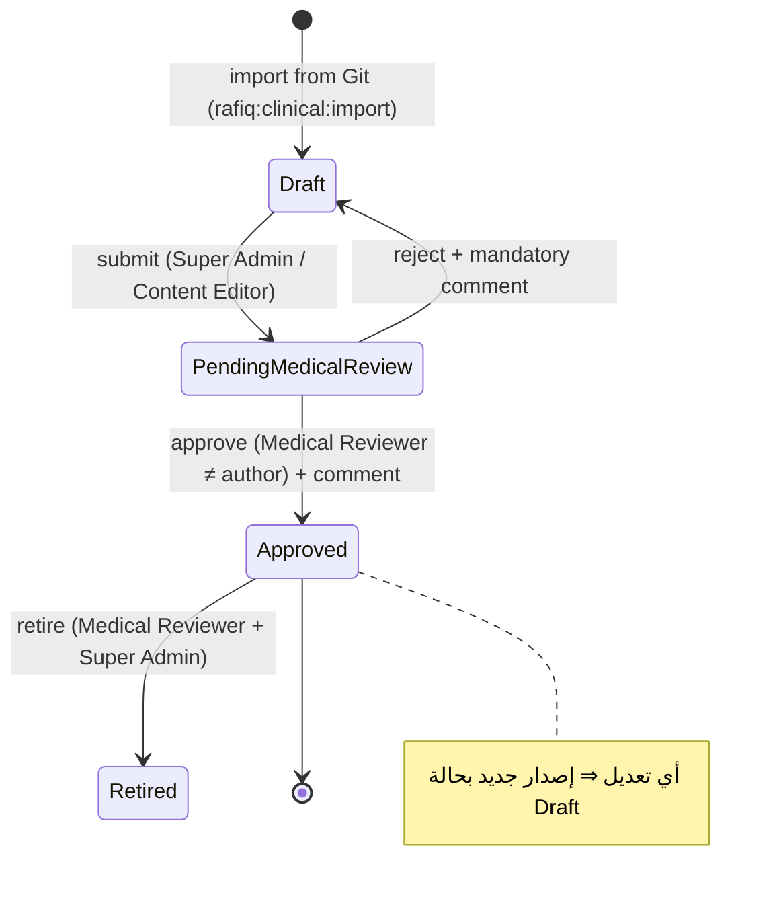

# عملية المراجعة السريرية (Clinical Review Process)

> **DRAFT – PENDING QUALIFIED MEDICAL REVIEW** — هذه العملية نفسها يجب أن يوافق عليها المراجع الطبي الرئيسي (Clinical Safety Owner).
> آخر تحديث: 2026-11-15

## 1. ما الذي يخضع للمراجعة الطبية

| العنصر | مثال | مراجعة لكل لغة؟ |
|---|---|---|
| قواعد سريرية (`clinical_rule_versions`) | CR-002 v1 | المنطق مرة واحدة؛ النصوص لكل لغة |
| أسئلة التقييم (`clinical_question_translations`) | صياغة `ss_sudden_severe_pain` | نعم |
| نصوص الإرشاد (`guidance_text_translations`) | نص شاشة P0 | نعم |
| قاموس علامات الخطر للـ AI (`red_flag_lexicon.json`) | "ألم مفاجئ شديد"، "sudden severe pain" | نعم |
| المقالات الطبية والمسرد وبنك أسئلة الطبيب | — | نعم |
| صفحة Under-18 ورسالة السلامة العامة SAFE-009 | — | نعم |
| Ruleset Release كاملاً | RS-2026.1 | — |

**لا يخضع:** نصوص الواجهة غير الطبية (أزرار، تنقل) — مراجعة تحريرية فقط.

## 2. الأدوار والأهلية

- **Medical Reviewer:** طبيب مرخّص في تخصص ذي صلة (مسالك/طب ذكورة/طب أسرة — يحدده المالك، OQ-003). يمنح Super Admin الدور بعد تسجيل `credential_verified_at` و`credential_reference` (ADM-003). لا نخزن صور الرخص.
- **مبدأ العينين الأربع:** لا يعتمد المراجع عنصراً هو كاتبه أو آخر من عدّله.
- **المراجعة ثنائية اللغة:** إن لم يكن المراجع يتقن اللغتين، يلزم مراجع ثانٍ للغة الأخرى أو مراجعة ترجمة معتمدة (OQ-029).

## 3. سير العمل — قاعدة سريرية

**ما يراه المراجع في شاشة المراجعة:**
1. الشرط مكتوباً كجملة مقروءة (مولّدة من JSON) + JSON الخام.
2. الأولوية والأعلام.
3. نصوص الإرشاد المرتبطة باللغتين.
4. المصادر مع تصنيف الدعم.
5. الفرق (diff) عن الإصدار السابق.
6. حالات الاختبار المتأثرة ونتيجتها الحالية.
7. أسئلة المراجعة المفتوحة (RQ-x).

## 4. سير العمل — Ruleset Release

| # | الخطوة | الفاعل | الشرط |
|---|---|---|---|
| 1 | إنشاء Release من مجموعة إصدارات قواعد + أسئلة + نصوص | Super Admin | — |
| 2 | تشغيل كل Clinical-Test-Cases على الخادم | النظام | كلها تمر ⇒ `tests_passed_at` + `test_report` |
| 3 | التحقق الآلي | النظام | كل العناصر `Approved` لكل اللغات؛ لا عبارات محظورة؛ لكل قاعدة مصدر أو تصنيف |
| 4 | الاعتماد الطبي للإصدار | Medical Reviewer | يقرأ التقرير ويقبل المخاطر المتبقية بتعليق |
| 5 | النشر | Super Admin (مع `password.confirm`) | 2–4 مكتملة |
| 6 | الإصدار السابق ⇒ Superseded | النظام | — |
| 7 | سجل التدقيق | النظام | لكل خطوة |

## 5. سير العمل — المحتوى

`Draft` → `Pending Medical Review` → `Approved` → `Published` / `Hidden` → `Archived`
- تعديل محتوى منشور ينشئ مسودة جديدة؛ النسخة المنشورة تبقى حتى اعتماد الجديدة.
- `review_due_at` افتراضياً +12 شهراً؛ قبل 30 يوماً يظهر تنبيه؛ عند تجاوزه يبقى منشوراً مع شارة "قيد التحديث" (OQ-030: أو يُخفى تلقائياً؟).

## 6. معايير المراجعة (Checklist للمراجع)

- [ ] المعلومة صحيحة ومتوافقة مع المصدر المذكور.
- [ ] تصنيف الدعم صحيح ([مصدر]/[استنتاج]/[مراجعة]).
- [ ] لا لغة تشخيصية، لا طمأنة زائفة، لا وصفات.
- [ ] الأولوية مناسبة، وحالات الحد مغطاة.
- [ ] الخطوة العملية قابلة للتطبيق في البلد المستهدف.
- [ ] الصياغة مفهومة لغير المختص بكلا اللغتين.
- [ ] الترجمة متكافئة في المعنى والإلحاح.
- [ ] نتائج حالات الاختبار المتوقعة صحيحة.

## 7. المراجعة الدورية والطارئة

- **دورية:** كل 12 شهراً لكل Release ومحتوى، أو عند صدور تحديث للمرجع (مثل إصدار EAU سنوي).
- **طارئة:** عند بلاغ سلامة، أو اكتشاف خطأ ⇒ kill switch (Security-Architecture §4) ⇒ مراجعة ⇒ إصدار تصحيحي.
- **سجل القرارات السريرية:** كل قرار للمراجع (اعتماد/رفض/قبول مخاطر) محفوظ في `audit_logs` و`review_comment`.

## 8. ما قبل وجود مراجع معتمد (الوضع الحالي)

- كل المحتوى والقواعد `Draft`.
- العرض في المسابقة بوضع Demo فقط مع الشريط التحذيري (FR-053).
- يُمنع وصف المنصة في العرض بأنها "معتمدة طبياً".
