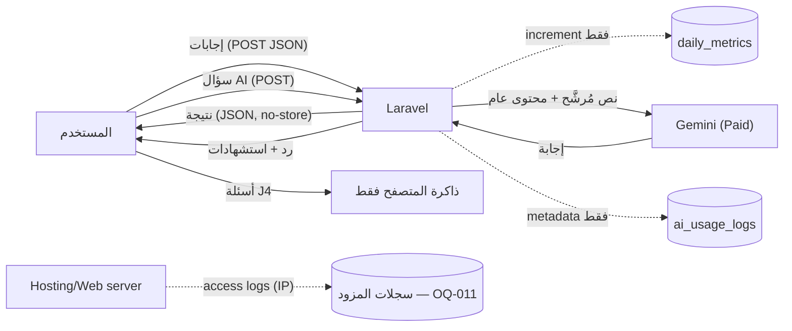

# متطلبات الخصوصية (Privacy Requirements)

> الحالة: Draft · آخر تحديث: 2026-11-15 · مرتبط بـ [Data-Inventory](Data-Inventory.md) · [Data-Lifecycle](Data-Lifecycle.md) · [Threat-Model](Threat-Model.md)
> **تنبيه قانوني:** لم تُحدد الولاية القضائية (OQ-002). المتطلبات أدناه مصممة وفق أشد المبادئ شيوعاً (Privacy by Design / GDPR Art. 25 كمرجع منهجي، وفق مهارة `privacy-by-design`)، ويجب مراجعتها قانونياً للبلد المستهدف (مثل PDPL الإماراتي أو السعودي) قبل الإطلاق العام.

## 1. Privacy by Design — المبادئ السبعة وتطبيقها

| المبدأ | التطبيق في رفيق |
|---|---|
| استباقي لا تفاعلي | إزالة الحاجة لتخزين البيانات الصحية من التصميم (ADR-003) بدل حمايتها لاحقاً. |
| الخصوصية كإعداد افتراضي | لا حساب، لا تخزين محلي افتراضياً، لا Analytics خارجية، AI معطل حتى الطلب والإقرار. |
| مدمجة في التصميم | قيود في Schema (لا جداول للإجابات)، في الكود (مرشحات AI)، وفي الاختبارات. |
| وظيفة كاملة (Positive-sum) | المسارات الأربعة تعمل بالكامل دون أي بيانات تعريفية. |
| أمن شامل لدورة الحياة | TLS، تشفير الجلسات، حذف مجدول للسجلات. |
| الشفافية | سياسة خصوصية بلغة بسيطة باللغتين؛ إشعارات سياقية؛ صدق حول IP واحتفاظ Google. |
| احترام المستخدم | زر "امسح كل شيء"، خروج سريع، لا إجبار على أي مسار. |

## 2. تقليل البيانات (Data Minimization)

| ما نحتاجه | لماذا | ما لا نجمعه بديلاً |
|---|---|---|
| تأكيد أن العمر ≥ 18 (منطقي) | الأهلية وشروط Gemini | تاريخ الميلاد، العمر الدقيق |
| إجابات التقييم (في الذاكرة + طلب واحد) | حساب الأولوية | أي تخزين |
| اللغة | الواجهة | الموقع الجغرافي |
| نص سؤال الـ AI (مُرشَّح، طلب واحد) | الإجابة | أي سجل للنص |
| عدادات يومية | تحسين المنتج | أحداث فردية، مسارات تنقل، بصمات |

## 3. المتطلبات

| ID | المتطلب | الأولوية | معايير القبول / الاختبار |
|---|---|---|---|
| PRIV-001 | لا جمع للاسم/الهاتف/البريد/الهوية/العنوان/تاريخ الميلاد من المستخدم العام في أي نموذج. | Must | مراجعة كل Form Request عامة: لا حقول بهذه الأنواع؛ اختبار Snapshot لقائمة الحقول المقبولة. |
| PRIV-002 | لا حسابات للمستخدمين العامين. | Must | `route:list` لا يحتوي `register` أو `login` خارج `/admin`. |
| PRIV-003 | لا بيانات صحية في URLs. | Must | كل endpoints التي تقبل إجابات/رسائل AI هي POST وترفض GET؛ البحث في مركز المعرفة يتم بـ POST (النص قد يكون حساساً) ونتائجه لا تغيّر الـ URL. |
| PRIV-004 | لا تخزين لإجابات/نتائج/تقارير/محادثات على الخادم. | Must | اختبار Feature يلتقط عدد الصفوف في كل الجداول قبل وبعد تقييم كامل ومحادثة AI: الفرق فقط في `daily_metrics` و`ai_usage_logs` (بلا نص). |
| PRIV-005 | جلسات عامة بلا IP/UA على مستوى التطبيق، مشفرة، خمول ≤ 30 دقيقة، تحتوي فقط المفاتيح المسموحة. | Must | اختبار يقرأ محتوى الجلسة بعد مسار كامل ويقارن بقائمة المفاتيح المسموحة (`locale`, `age_confirmed`, `assessment_consent`, `ai_notice_ack`, `_token`, `welcomed`). |
| PRIV-006 | لا Analytics أو pixels أو خطوط أو CDNs طرف ثالث في الصفحات العامة. | Must | CSP بـ `default-src 'self'`؛ الخطوط مستضافة ذاتياً (تنبيه: `vite.config.js` الحالي يستخدم `bunny` fonts — يجب استبداله بخطوط مستضافة ذاتياً أو التحقق من أنه يولّد ملفات محلية عند البناء — GAP). |
| PRIV-007 | صدق الادعاءات: لا "مجهول 100%". النص يذكر: مزود الاستضافة قد يسجل IP تقنياً؛ Google تحتفظ بطلبات الـ AI لفترة محدودة لمراقبة الإساءة (55 يوماً وفق SRC-007)؛ نستخدم IP مجزّأ مؤقتاً لحدود المعدل. | Must | مراجعة نص السياسة مقابل Data-Inventory. |
| PRIV-008 | لا cache متصفح للصفحات الحساسة؛ تشفير تاريخ Inertia (`encryptHistory`) لصفحات J2/J3/J4/AI؛ `clearHistory` عند "امسح كل شيء". | Must | اختبار الترويسات؛ اختبار يدوي لزر الرجوع بعد الخروج. |
| PRIV-009 | لا تسجيل لأجسام الطلبات/الرسائل؛ حذف المفاتيح الحساسة من سياق الاستثناءات؛ `dontFlash` يشمل مفاتيح الإجابات. | Must | test يرمي استثناء أثناء التقييم ثم يفحص ملف السجل. |
| PRIV-010 | بيانات اصطناعية فقط في Demo وفي الاختبارات. | Must | Seeders تحمل بادئة `[SYNTHETIC]` في الحقول النصية للأدمن والمحتوى التجريبي. |
| PRIV-011 | حذف: "امسح كل شيء" (يمسح React state + localStorage الاختياري + يبطل الجلسة)؛ وأمر `rafiq:prune` مجدول يومياً. | Must | Feature test للجلسة؛ test لأمر الحذف. |
| PRIV-012 | إشعار خصوصية سياقي قبل J2/J3 (FR-021) وقبل الـ AI (FR-022) وفي J4 (FR-092). | Must | — |
| PRIV-013 | موافقة صريحة لمعالجة بيانات صحية مؤقتة (J2/J3)، غير محددة مسبقاً، قابلة للسحب (الخروج = سحب). | Must | — |
| PRIV-014 | لا بيانات صحية لأي طرف ثالث (Gemini يستقبل فقط نصاً مُرشَّحاً + محتوى عام). | Must | AI-008 test. |
| PRIV-015 | لوحة الإدارة لا تتيح أي وصول لبيانات المستخدمين (لا توجد أصلاً). | Must | ADM-060. |
| PRIV-016 | إحصاءات مجمعة يومياً فقط، مع إخفاء الأعداد < 5 في العرض. | Must/Should | ADM-050/051. |
| PRIV-017 | الطباعة والحفظ يتمان محلياً في المتصفح دون طلبات شبكة. | Must | اختبار شبكة. |
| PRIV-018 | `localStorage` لا يُستخدم إلا بخيار صريح في J4 (FR-095) مع تحذير الأجهزة المشتركة وزر حذف. | Could | — |
| PRIV-019 | سياسة الخصوصية تتضمن: من نحن (جهة الاتصال — OQ-031)، ما نعالجه ولماذا، ما لا نجمعه، الأطراف الثالثة (Google Gemini، الاستضافة)، الاحتفاظ، الحقوق، تاريخ آخر تحديث. | Must | Checklist قانوني. |
| PRIV-020 | تقييم أثر حماية البيانات (DPIA) قبل الإطلاق العام. | Must (Launch) | وثيقة موقّعة (Module-12). |
| PRIV-021 | عناوين تبويب المتصفح (`<title>`) لصفحات المسارات والتقييم والـ AI محايدة ("رفيق | Rafiq")؛ صفحات المسارات والتقييم `noindex`. | Should | Feature test للـ title وmeta robots. |

## 4. تدفق البيانات (Data Flow)

البيانات الصحية **لا** تصل إلى: قاعدة البيانات، الجلسة، السجلات، الـ cache، الطوابير، Gemini، أي Analytics.

## 5. الحقوق

بما أننا لا نحتفظ ببيانات شخصية للمستخدمين العامين، فطلبات الوصول/التصحيح/المحو تُجاب بأنه لا توجد بيانات قابلة للربط بشخص. يُوثّق مسار للتواصل (OQ-031). الحقوق تنطبق بالكامل على حسابات الأدمن.
