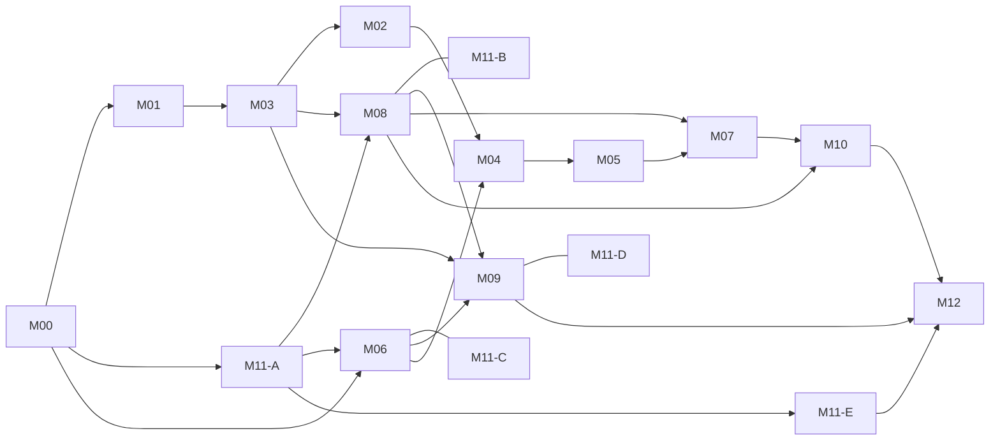

# خارطة طريق التنفيذ (Implementation Roadmap)

> الحالة: Draft · آخر تحديث: 2026-11-15 · التقديرات لمطور Full-stack واحد بدوام كامل مع دعم منتج/تصميم جزئي؛ تُعدّل بعد معرفة موعد المسابقة (OQ-001) وحجم الفريق.

## 1. ترتيب التنفيذ (مختلف عن ترقيم الملفات عمداً)

ترقيم ملفات الوحدات يتبع الـ Brief؛ ترتيب التنفيذ يتبع الاعتماديات بحيث **لا تُبنى وحدة قبل ما تعتمد عليه**:

| # | الوحدة | تعتمد على | التقدير (أيام) | المرحلة |
|---|---|---|---|---|
| 1 | M00 Foundation | — | 4–6 | P1 |
| 2 | M01 Welcome & Landing | M00 | 4–5 | P1 |
| 3 | M03 Privacy, Age & Consent | M00, M01 | 3–4 | P1 |
| 4 | M02 Journey Selection | M01, M03 | 2–3 | P1 |
| 5 | M11-A Admin Auth/Roles/Audit | M00 | 3–4 | P2 |
| 6 | M08 Knowledge Center + M11-B Content Mgmt | M03, M11-A | 6–8 | P2 |
| 7 | M06 Clinical Rules Engine + M11-C Rules Mgmt | M00, M11-A | 7–9 | P3 |
| 8 | M09 AI Companion + M11-D AI Config | M03, M08, M06 (lexicon), M11-A | 8–10 | P4 |
| 9 | M04 Safety Screening | M03, M06, M02 | 3–4 | P3 |
| 10 | M05 Assessment | M04, M06 | 4–5 | P3 |
| 11 | M07 Guidance & Report | M05, M06, M08 | 4–5 | P3 |
| 12 | M10 Doctor Visit Prep | M03, M08, M07, (M09) | 3–4 | P4 |
| 13 | M11-E Analytics | M11-A + العدادات | 2 | P5 |
| 14 | M12 Testing & Launch | الكل | 5–7 | P5 |
| | **المجموع التقريبي** | | **58–76 يوماً** | |

> **ملاحظة ترتيب:** M09 (الخطوة 8) قبل M04 (الخطوة 9) لإبراز الـ AI مبكراً للمسابقة؛ هذا ممكن لأن M09 يحتاج من M06 ملف `red_flag_lexicon` فقط. إن كانت الأولوية للمسار السريري، يمكن تبديل الخطوتين 8 و9–11 دون كسر الاعتماديات.

## 2. المراحل (Phases)

| المرحلة | الهدف | الوحدات | المُخرَج القابل للعرض | بوابة الخروج |
|---|---|---|---|---|
| **P0 — مراجعة التوثيق** | اعتماد هذه الوثائق وحسم القرارات الحرجة | — | وثائق معتمدة | إغلاق OQ-001/002/003/005/006/018 أو قبول الافتراضات |
| **P1 — الهيكل العام** | تجربة ثنائية اللغة من الترحيب حتى اختيار المسار | M00, M01, M03, M02 | Landing + بوابات + المسارات (placeholders) | CI أخضر، axe/RTL |
| **P2 — المحتوى** | مركز معرفة يُدار بالكامل من لوحة الإدارة بسير اعتماد | M11-A, M08, M11-B | J1 كامل ببيانات اصطناعية | مصفوفة صلاحيات 11-A/B خضراء |
| **P3 — المسار السريري** | محرك قواعد وفحص خطر وتقييم وتقرير في Demo | M06, M11-C, M04, M05, M07 | J2 وJ3 كاملان (Demo) | TC-01..37 خضراء |
| **P4 — الذكاء والتحضير** | AI Companion وتحضير الطبيب | M09, M11-D, M10 | J4 + AI في كل المسارات | بوابات AI eval الحرجة |
| **P5 — التصليب والعرض** | إحصاءات، اختبار شامل، Demo | M11-E, M12 | نسخة المسابقة | بوابة Demo (M12 §12) |
| **P6 — ما بعد المسابقة** | الإطلاق العام | اعتماد طبي، قانوني، مؤجلات مختارة | — | بوابة الإطلاق العام |

## 3. MVP مقابل المؤجل

| داخل الـ MVP (Demo المسابقة) | مؤجل (P6 أو لاحقاً) |
|---|---|
| المسارات الأربعة؛ Ruleset Draft في Demo | اعتماد طبي كامل وإطلاق عام |
| AI: platform_guide, explain_article, explain_term, general_education (قابل للتعطيل) | AI لصياغة أسئلة المستخدم (DF-02) |
| بحث FULLTEXT | Embeddings (DF-03) |
| لوحة إدارة كاملة (A–E) | تحرير منطق القواعد بالواجهة (DF-04) |
| Markdown editor | Rich text، وسائط، فيديو (DF-08) |
| عربي/إنجليزي | لغات أخرى (DF-06) |
| localStorage اختياري في J4 (Could) | حسابات المستخدمين (DF-01) |
| Developer API Paid | Vertex AI (DF-09) |

## 4. إذا كان الوقت أقصر من التقدير (خطة تقليص)

بترتيب الحذف المقترح دون المساس بالسلامة/الخصوصية:
1. M11-E Analytics ⇒ عدادات في قاعدة البيانات دون شاشة (عرض عبر أمر CLI).
2. UC-04 `general_education` ⇒ معطل.
3. FR-095 localStorage، FR-005 اختصار Esc (يبقى الزر)، M10-FR-04 قوالب الصياغة.
4. شاشات 11-C المتقدمة (Diff/ReadableCondition) ⇒ عرض JSON + تقرير الاختبارات فقط.
5. **لا يُحذف أبداً:** Safety Screening وشاشة P0، البوابات، المرشحات الحتمية للـ AI، اختبارات TC، عدم التخزين، الشريط التحذيري، ثنائية اللغة.

## 5. المعالم (Milestones)

| المعلم | المحتوى | بعد |
|---|---|---|
| MS-1 | "Hello Rafiq" ثنائي اللغة على Inertia/React | M00 |
| MS-2 | Landing + بوابات + اختيار المسار | P1 |
| MS-3 | J1 كامل + الإدارة للمحتوى | P2 |
| MS-4 | J2/J3 في Demo مع TCs | P3 |
| MS-5 | AI + J4 | P4 |
| MS-6 | Demo جاهز للمسابقة | P5 |

## 6. الوحدة الموصى بالبدء بها

**Module-00 Foundation** — بعد موافقة المالك على: تثبيت Laravel Boost والحزم (GAP-01..05/07/08/13)، ADR-002 (MySQL)، ADR-004 (الجلسات)، ADR-011/015 (اللغة). كل الوحدات الأخرى تعتمد عليه، ولا يتطلب أي قرار طبي.
